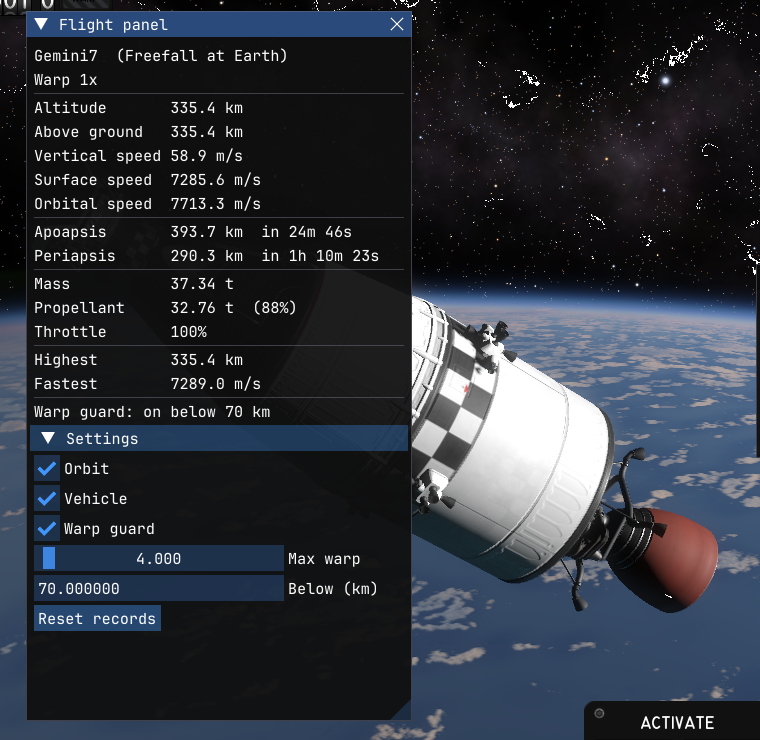

# Flight Panel

A [Kitten Space Agency](https://ksa.ahwoo.com) mod written in Rust, run by
[Oxidizer](https://github.com/SafeShows/Oxidizer). It is a complete, working example of what an Oxidizer mod can do,
kept small enough to read in one sitting.



- **Flight panel:** live flight data in a window: altitude, height above ground, vertical, surface and orbital speed,
  apoapsis and periapsis with countdowns, mass, propellant, throttle and time warp, plus the highest and fastest the
  vehicle has been.
- **Warp guard:** below an altitude you set (70 km by default), time warp can't go past a speed you set (4x by
  default), and the game's auto-warp won't start.
- **Settings** in the panel, saved across games.
- **F7** shows and hides the panel, **F6** turns the warp guard on and off. Both are in the game's **Mods** menu too.

## Install

With a mod manager such as Borea, install **Flight Panel**: it brings Oxidizer along. By hand:

1. Install Oxidizer, as a StarMap mod (`Oxidizer.StarMap`) or standalone; see
   [Oxidizer's install steps](https://github.com/SafeShows/Oxidizer#install).
2. Unzip `flight_panel-X.Y.Z.zip` from the [releases](../../releases) into
   `Documents/My Games/Kitten Space Agency/mods/`, so there is a `mods/flight_panel/` folder.
3. Start the game and enable the mod when it asks.

Windows, Linux and macOS (Apple Silicon, with the [macOS port](https://github.com/renancamm/ksa-macos-port)).

## How it's made

Each file shows one part of Oxidizer's Rust API ([`oxidizer_api`](https://docs.rs/oxidizer_api)):

| File | Shows |
|---|---|
| [`src/lib.rs`](src/lib.rs) | The `Mod` trait: `init`, `frame` (every frame), `gui` (ImGui windows), `menu` (the Mods menu). Hotkeys with `key_pressed`. A window with a close button, colored text, collapsing sections, checkboxes, a slider and a number field. |
| [`src/game.rs`](src/game.rs) | Reading the game: small typed wrappers (`Vehicle::controlled()`, `v.altitude()`) over the by-name API (`Obj::get`, `Obj::call`, `Obj::static_get`). |
| [`src/warp_guard.rs`](src/warp_guard.rs) | Patching the game with `hook`: a prefix that skips the game's `Universe.IncreaseSimulationSpeed`, and a postfix that changes what `Universe.CanAutoWarp` returns with `set_hook_result`. How hooks share state with the mod (atomics: hooks run inside the game's calls, without `&mut self`). |
| [`src/settings.rs`](src/settings.rs) | Settings in `config_path("flight_panel")`, which is `<game documents>/oxidizer/flight_panel.toml`, outside the mod folder so updates keep them. |

The by-name API finds members when it runs, so the mod keeps working across game updates as long as the names
exist. Oxidizer can also generate typed bindings for the whole game (`oxidizer --bindgen src/ksa.rs`), which check
everything at compile time but belong to one game build; see the
[Rust mod template](https://github.com/SafeShows/oxidizer-rust-mod-template) for both.

To find the game's types and members, open `KSA.dll` from the game folder in a .NET decompiler such as ILSpy, or
look in the editor definitions Oxidizer writes to `<game documents>/oxidizer/definitions/`.

## Build

Install [Rust](https://rustup.rs), then build and copy the mod into the game's mods folder (quit the game first on
Windows, which keeps the loaded library locked):
```sh
./install.ps1    # Windows
./install.sh     # Linux, macOS
```
Both take the mods folder as an argument if the game isn't in the usual place. **Mods > Oxidizer** in the game shows
the mod's log and errors.

Pushing a tag like `v1.0.0` makes the release workflow build Windows, Linux and macOS libraries and publish
`flight_panel-1.0.0.zip`, with `THIRD-PARTY-NOTICES.txt` for the crates compiled in (`scripts/notices.py`).

## License

[MIT No Attribution](LICENSE): copy any of it into your own mod, no credit needed.
